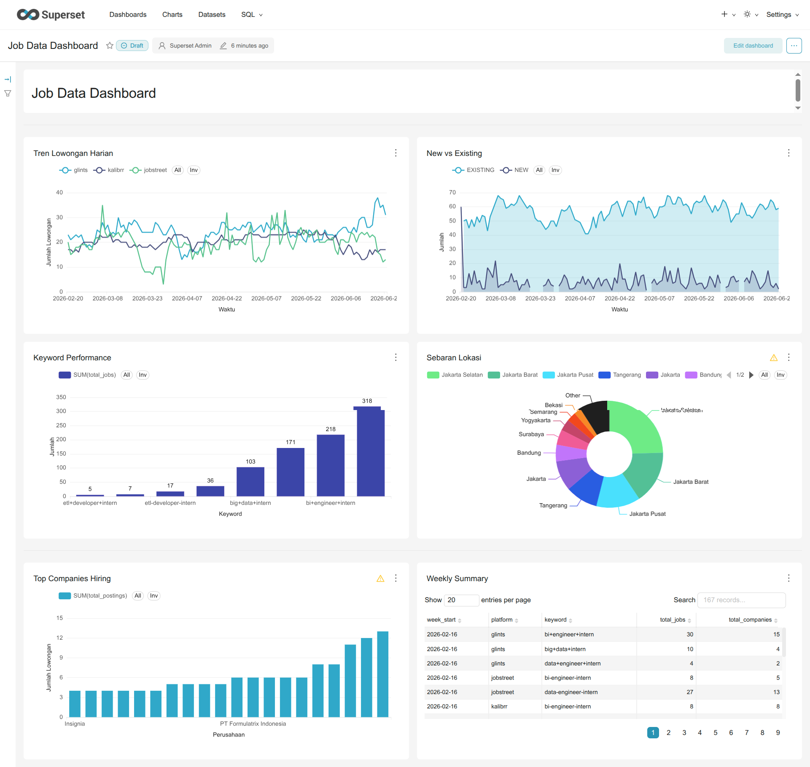

# Job Data Pipeline

Fully automated data pipeline that scrapes job postings from multiple platforms, transforms data through medallion architecture, applies AI-based job description parsing, and sends real-time Slack alerts.

[](https://github.com/S4njuuu3291/job-data-pipeline/actions)
[](https://www.terraform.io/)
[](https://python.org)
[](https://aws.amazon.com/)
[](https://superset.apache.org/)

## Architecture


**System Components:**  Web Scrapers (3x parallel) • ⚙ Silver transformer (w/ AI parsing) •  Step Functions •  EventBridge •  Slack alerter •  Superset Dashboard •  S3 + Athena/Glue •  IAM security

## What It Does

**Ingests** job postings from 3 platforms → **Parses** job descriptions with AI (DeepSeek-V4-Flash) → **Transforms** via medallion layers → **Queries** with Athena → **Alerts** via Slack

### Data Pipeline

| Layer | What | Where | Format | Retention |
|-------|------|-------|--------|-----------|
| **Bronze** | Raw scraped data | S3 `jobscraper-bronze-data` | JSON | 30 days |
| **Silver** | Cleaned, validated + AI-parsed attributes | S3 `jobscraper-silver-data` | Parquet (partitioned) | 90 days |
| **Gold** | Analytics views | Athena `v_job_*` views | SQL queryable | Live |
| **Dashboard** | Superset BI | `http://localhost:8088` | Charts & Tables | - |
| **Alert** | Slack notification | Slack channel | Formatted blocks | -

## Multi-Environment Architecture

Project menggunakan arsitektur **multi-environment (dev/prod)** dengan directory separation + shared modules.

> **ADR Terkait:**
> - [`ADR-001-migration-to-multi-environment.md`](docs/adr/ADR-001-migration-to-multi-environment.md)
> - [`ADR-002-migrasi-parsing-job-description-ke-ai-based-extraction.md`](docs/adr/ADR-002.md)

| Aspek | Prod | Dev |
|-------|------|-----|
| **Terraform** | `terraform/envs/prod/` | `terraform/envs/dev/` |
| **State file** | `terraform.tfstate` | `dev/terraform.tfstate` |
| **S3 bucket** | `jobscraper-bronze-data` | `jobscraper-bronze-data-dev` |
| **Lambda** | `jobscraper-scraper` | `jobscraper-scraper-dev` |
| **ECR repo** | `job-scraper-lambda` | `job-scraper-lambda-dev` |
| **Glue DB** | `jobscraper_db` | `jobscraper_db_dev` |
| **CI/CD trigger** | Push ke `main` | Push ke `dev` |

Semua resource dev menggunakan suffix `-dev` untuk isolasi total dari prod.

## CI/CD Pipeline

Pipeline otomatis via GitHub Actions (`.github/workflows/ci-cd.yml`):

| Branch | Workflow |
|--------|----------|
| `main` | Prod — deploy ke `terraform/envs/prod/` |
| `dev` | Dev — deploy ke `terraform/envs/dev/` |

Setiap deploy terdiri dari 3 phase:
1. **Phase 1:** Terraform apply — infra + Lambda
2. **Phase 2:** Build & push Docker image ke ECR
3. **Phase 3:** Terraform apply — update Lambda dengan image baru

## Execution Flow

```
EventBridge (Scheduled: 9 AM & 4 PM WIB)
    ↓
Step Functions State Machine
    ├─ Kalibrr Scraper (Parallel)
    ├─ Glints Scraper (Parallel)
    └─ JobStreet Scraper (Parallel)
    ↓ (wait all scrapers)
Silver Layer Transformation
    ├─ AI Parsing (DeepSeek-V4-Flash) — extract salary, skills, seniority, etc.
    ├─ Validate & deduplicate
    ├─ Normalize fields
    └─ Store as Parquet (partitioned by date)
    ↓
Slack Alert Lambda
    ├─ Query new jobs from Athena
    ├─ Format message with job details
    └─ Send to Slack webhook
    ↓
Success
```

### Real Execution Example

Last successful run with metrics:

| Task | Type | Status | Duration | Timeline |
|------|------|--------|----------|----------|
| **kalibrr-scraper** | Lambda |  Succeeded | 31.5s | 00:00:00 |
| **glints-scraper** | Lambda |  Succeeded | 44.0s | 00:00:00 |
| **jobstreet-scraper** | Lambda |  Succeeded | 53.7s | 00:00:00 |
| **ScrapersParallel** | Parallel |  Succeeded | 53.7s | (all parallel) |
| **SilverLayerTransform** | Lambda |  Succeeded | 7.3s | 00:00:53 |
| **SlackAlertNotification** | Lambda |  Succeeded | 3.6s | 01:00:00 |
| **Total Pipeline** | State Machine |  Succeeded | **64.6s** | - |

**Key Metrics:**
- ⚡ Parallel execution reduces total time (3 scrapers × 45s avg = ~45s instead of 135s)
-  Silver layer processes data in 7.3s
-  Slack notification sent in < 4 seconds
-  End-to-end pipeline: **~65 seconds**

### Job Collection Statistics

Typical run collects across all platforms:

| Platform | Scraped | New | Re-post | Processing Time |
|----------|---------|-----|---------|-----------------|
| **Glints** | 3 | 2 | 1 | 31.5s |
| **JobStreet** | 4 | 4 | 0 | 44.0s |
| **Kalibrr** | 2 | 1 | 1 | 53.7s |
| **Total** | **9** | **7** | **2** | **53.7s** |

### Step Functions Graph View


**Flow:** EventBridge trigger → 3x Scrapers (parallel) → Silver validation → Slack alert → Success. Failure → DLQ for investigation.

## Project Structure

```
job-data-pipeline/
├── src/
│   ├── ai/                       # AI parsing module (DeepSeek client)
│   │   └── nlp.py                #   API wrapper, prompts, cost tracking
│   ├── scraper/                  # Web scrapers (3 platforms)
│   │   ├── jobscraper_kalibrr.py
│   │   ├── jobscraper_glints.py
│   │   └── jobscraper_jobstreet.py
│   ├── silver_layer/             # Data transformation, validation & AI parsing
│   │   ├── config.py             # Schema & rules (25+ fields)
│   │   ├── transformations.py    # Cleaning
│   │   ├── validators.py         # Quality checks
│   │   ├── storage.py            # S3 & partitioning
│   │   └── orchestrator.py       # Workflow (incl. AI parsing step)
│   ├── slack-alert/              # Slack notification
│   │   └── slack_handler.py      # Athena query & send
│   ├── utils/                    # Helpers
│   └── entrypoint/               # Lambda handlers
├── terraform/                    # Infrastructure as Code
│   ├── modules/                  # Shared Terraform modules
│   │   ├── lambda.tf             # Lambda functions
│   │   ├── iam.tf                # IAM roles & policies
│   │   ├── storage.tf            # S3 buckets
│   │   ├── ecr.tf                # ECR repositories
│   │   ├── catalog.tf            # Glue Catalog
│   │   ├── orchestration.tf      # Step Functions
│   │   ├── monitoring.tf         # CloudWatch
│   │   ├── ssm.tf                # Parameter Store
│   │   └── variables.tf          # Module variables
│   ├── envs/
│   │   ├── prod/                 # Production (suffix-less)
│   │   │   ├── main.tf           # Root module call
│   │   │   ├── backend.tf        # S3 remote state
│   │   │   └── terraform.tfvars  # Environment vars
│   │   └── dev/                  # Development (-dev suffix)
│   │       ├── main.tf
│   │       ├── backend.tf
│   │       └── terraform.tfvars
│   └── step_functions/
│       └── JobScraperMachine.asl.json
├── lambda-layers/                # Python dependencies
```

## Components

### Lambda Functions Performance

| Component | Memory | Timeout | Avg Duration | Cold Start | Parallelism |
|-----------|--------|---------|--------------|------------|------------|
| **Kalibrr Scraper** | 3GB | 15min | 31.5s | ~0.5s | 1 |
| **Glints Scraper** | 3GB | 15min | 44.0s | ~0.5s | 1 |
| **JobStreet Scraper** | 3GB | 15min | 53.7s | ~0.5s | 1 |
| **Silver Layer** | 1GB | 5min | 7.3s | ~0.3s | 1 |
| **Slack Alert** | 512MB | 1min | 3.6s | ~0.2s | 1 |

**Scraper Details:**
- Use Playwright with stealth plugins to bypass anti-bot detection
- Target keywords: `data-engineer-intern`, `etl-developer-intern`, `big-data-intern`, `bi-engineer-intern`
- Container image stored in ECR (Amazon Linux 2, Python 3.12)
- Retry policy: 2 attempts with exponential backoff
- Dead Letter Queue enabled for failed invocations

**Silver Layer Details:**
- **AI Parsing:** Extracts structured attributes (role, salary, seniority, skills, job_type, work_mode, etc.) from raw job description using **DeepSeek-V4-Flash**
- **Job ID dedup:** Leverages the scraper-level `job_id` manifest to skip re-processing jobs that have already been scraped and parsed
- Validates 25+ field schema using Pandera (includes AI-parsed fields)
- Deduplicates by `job_id` (MD5 hash of normalized job URL)
- Normalizes platform names and locations
- Marks as `NEW` if not in previous 7 days, else `RE-POST`
- Partitions by `ingestion_date` and `platform`
- Stores in Parquet format with snappy compression

**Slack Alert Details:**
- Queries Athena: `SELECT * FROM v_jobscraper_clean WHERE ingestion_date = TODAY AND discovery_type = 'NEW'`
- Uses Slack Block Kit for mobile-optimized formatting
- Platform emoji icons:  Glints,  JobStreet, ⭐ Kalibrr
- Shortened URLs via TinyURL API (fallback to original on timeout)
- Gracefully handles empty result sets
- Lambda Layer: `requests` library for HTTP calls

### AI-Based Job Description Parsing

Job descriptions from all platforms are parsed using **DeepSeek-V4-Flash** to extract structured attributes for analytics (salary trends, skill demand, seniority distribution, etc.).

**Extracted Attributes:**

| Attribute | Type | Description |
|-----------|------|-------------|
| `title` | string | Job title |
| `role` | string | Core role (without seniority prefix) |
| `company_name` | string | Company name |
| `location` | string | City or "Remote" |
| `salary_min` / `salary_max` | int | Salary range (0 if not listed) |
| `salary_currency` | enum | IDR / USD / SGD / MYR |
| `salary_period` | enum | monthly / yearly |
| `job_type` | enum | full_time / part_time / contract / internship / freelance |
| `seniority` | enum | intern / entry / mid / senior / lead / manager / executive |
| `work_mode` | enum | on_site / hybrid / remote / unknown |
| `skills` | array | Extracted skills (e.g. ["python","sql"]) |
| `benefits` | array | Listed benefits |
| `experience_min` / `experience_max` | int | Required experience (years) |
| `education` | string | Minimum education level |
| `company_industry` | string | Company industry |
| `posting_date` | date | Job posting date (ISO 8601) |

**Cost Estimation:**

| Component | Price per 1M tokens | Tokens per call | Cost per call |
|:---|---:|:---:|:---:|
| Input (cache miss) | $0.14 | ~1,000 | $0.00014 (~Rp 2.2) |
| Output | $0.28 | ~50 | $0.000014 (~Rp 0.22) |
| **Total** | | | **$0.000154 (~Rp 2.4)** |

**Incremental Processing (Job ID Dedup):**
- At the scraper level, each job receives a `job_id` (MD5 hash of the normalized job URL)
- Before scraping details, the scraper reads a Parquet manifest at `manifests/<platform>/job_ids.parquet` in the Bronze bucket
- If `job_id` exists → skip entirely (no Playwright request, no downstream processing)
- Only new jobs proceed to Bronze → Silver → AI parsing
- **Impact:** Eliminates 80–90% of redundant scraping daily; AI costs stay at **~Rp 300-500/day**

```
Scrape job cards → Compute job_id (MD5 of URL) → Check manifest/
  ├── Hash exists → Skip job entirely
  └── New job → Scrape details → Bronze → AI parse → Silver
```

> **ADR Terkait:** [`ADR-002-migrasi-parsing-job-description-ke-ai-based-extraction.md`](docs/adr/ADR-002.md)

### Slack Alert Message Example

Every day at 9 AM & 4 PM WIB, you receive a formatted Slack notification:


**Features:**  Block Kit (mobile) •  One-click Open button •  Platform emojis •  WIB timezone

**25+ Fields** (validation in `src/silver_layer/config.py`):

```
job_id (hash)      | job_title         | company_name      | location
job_url            | platform          | scraped_at        | keyword  
discovery_type     | [normalized fields]

# AI-parsed fields (via DeepSeek-V4-Flash):
role               | salary_min        | salary_max        | salary_currency
salary_period      | job_type          | seniority         | work_mode
skills (JSON arr)  | benefits (JSON)   | experience_min    | experience_max
education          | company_industry  | posting_date
```

**Bronze**: Raw JSON from scrapers  
**Silver**: Cleaned Parquet, deduplicated, partitioned by date

## Quick Start

### Prerequisites
```bash
Python 3.12, Poetry, Terraform ≥1.0, Docker, AWS CLI, GitHub account
```

### 1. Clone & Install
```bash
git clone https://github.com/S4njuuu3291/job-data-pipeline.git
cd job-data-pipeline
poetry install
poetry run playwright install chromium
```

### 2. Configure AWS & Secrets
```bash
aws configure  # Set region: ap-southeast-1
```

GitHub Secrets (Settings → Secrets → Actions):
- `SLACK_WEBHOOK_URL`: Your Slack webhook (optional, defaults to SSM Parameter)
- `DEEPSEEK_API_KEY`: DeepSeek API key for AI job parsing (stored in SSM Parameter Store)

AWS SSM Parameter Store:
- `/jobscraper/DEEPSEEK_API_KEY`: DeepSeek API key (used by Silver Layer Lambda)

### 3. Deploy

```bash
# Prod (existing infra)
make tf-prod-apply

# Dev (build & push image dulu)
make docker-ecr-push-dev
make tf-dev-apply

# Manual:
# Prod: cd terraform/envs/prod && terraform apply -var-file=terraform.tfvars --auto-approve
# Dev:  cd terraform/envs/dev  && terraform apply -var-file=terraform.tfvars --auto-approve
```

Terraform will:
- Create S3 buckets (bronze, silver, athena results)
- Deploy 5 Lambda functions (3 scrapers + silver + slack)
- Setup Step Functions state machine
- Configure EventBridge schedules
- Create Glue catalog & Athena workgroup
- Setup IAM roles & policies secure permissions

## Testing

```bash
# Run all tests
make test

# Format code
make fmt

# Type check
make mypy

# Full CI
make ci
```

## Usage

### Manual Trigger
```bash
# Test Slack Lambda directly
aws lambda invoke --function-name jobscraper-slack-alert \
  --payload '{}' /tmp/response.json
cat /tmp/response.json
```

### Query Results (Athena)
```sql
SELECT platform, COUNT(*) as job_count, COUNT(DISTINCT discovery_type) 
FROM jobscraper_db.jobscraper_silver_table
WHERE ingestion_date = '2026-03-06'
GROUP BY platform;
```

### View Logs
```bash
# Lambda logs
aws logs tail /aws/lambda/jobscraper-slack-alert --follow

# Step Functions
aws logs tail /aws/stepfunctions/jobscraper-orchestrator --follow
```

## Dashboard (Superset)

Visual analytics dashboard powered by Apache Superset connected to Athena.



### Analytics Views (Athena)

| View | Content | Chart |
|------|---------|-------|
| `v_job_daily_trend` | Tren lowongan per hari per platform | Line Chart |
| `v_job_top_companies` | Perusahaan paling banyak hiring | Bar Chart |
| `v_job_location_stats` | Sebaran lokasi lowongan | Pie Chart |
| `v_job_new_vs_existing` | Perbandingan NEW vs EXISTING | Area Chart |
| `v_job_keyword_performance` | Keyword paling produktif | Bar Chart |
| `v_job_weekly_summary` | Rangkuman mingguan | Table |

### Running Locally

```bash
# Build images
make docker-build

# Start containers
make docker-up

# Init database & admin user
make init-superset

# Open http://localhost:8088 (admin:admin)
# Add Athena connection via UI → Settings → Database Connections
```

**Connection Details:**
| Parameter | Value |
|-----------|-------|
| Database type | Amazon Athena |
| S3 staging dir | `s3://weather-data-lake-sanju/athena-query-results/jobscraper/` |
| Database | `jobscraper_db` |
| Workgroup | `jobscraper-slack-alert-workgroup` |
| Region | `ap-southeast-1` |

### Dashboard Charts

| Tab | Charts | Dataset |
|-----|--------|---------|
| **Overview** | Line: Daily Trend + Area: NEW vs EXISTING | `v_job_daily_trend`, `v_job_new_vs_existing` |
| **Companies** | Bar: Top Companies Hiring | `v_job_top_companies` |
| **Locations** | Pie: Location Distribution | `v_job_location_stats` |
| **Keywords** | Bar: Keyword Performance | `v_job_keyword_performance` |
| **Summary** | Table: Weekly Summary | `v_job_weekly_summary` |

 Dashboard export: `dashboards/dashboard_export_20260621T133818.zip`

## Security

- **GitHub OIDC** for CI/CD (no AWS keys in repo)
- **IAM least privilege**: Each Lambda role has minimal permissions
- **SSM Parameter Store**: Slack webhook encrypted (SecureString)
- **S3 public access**: Block all enabled
- **ECR**: Image scanning on push

## Cost

**~$0.15/month** within AWS Free Tier:
- Lambda: 180 invocations/month × 2 seconds ~ $0.00
- S3: ~5 GB storage, <100 requests ~ $0.00
- ECR: 1 image @ 500MB ~ $0.10
- Athena/Glue: Under free tier limits ~ $0.00
- EventBridge: Always free

## Architecture Decisions

- **[ADR-001](docs/adr/ADR-001-migration-to-multi-environment.md):** Migrasi ke arsitektur multi-environment (dev/prod) dengan directory separation + shared modules.
- **[ADR-002](docs/adr/ADR-002.md):** Migrasi parsing job description ke AI-based extraction menggunakan DeepSeek-V4-Flash.

## License

MIT - See [LICENSE](LICENSE)

---

**Made with ❤️ by Sanju**  
 